# Predicting traditional bank use among Kenyan adults, with a gender-fairness audit

**DSA 8401 Applied Machine Learning - Capstone Project**, Strathmore University (iLabAfrica)
Author: Faith Makena Riungu

## Overview

Kenya's formal financial inclusion is high, but women remain much less likely
than men to use a traditional bank. This project builds an end-to-end machine
learning system that predicts whether an adult uses a traditional (commercial)
bank, using the **2024 FinAccess Household Survey**. It then asks whether the
model is equally reliable for women and men.

| | |
| --- | --- |
| **Task** | Binary classification: traditional bank use (1) vs non-use (0) |
| **Data** | FinAccess 2024, 19,750 adults (18+), 35 predictors, 1,849 survey clusters |
| **Champion** | Gradient boosting, chosen by nested cluster-aware CV (weighted PR-AUC) |
| **Test result** | Weighted PR-AUC 0.753 (chance 0.304), ROC-AUC 0.871, Brier 0.131 |
| **Fairness finding** | At the 0.50 threshold, recall is 52% for women vs 67% for men (gap +15.6 pp, 95% CI 7.2-23.1). At the deployed 0.320 threshold, the gap narrows to +9.1 pp (2.2-15.5). |

Gender is **not** a model input. It is used only to evaluate the model by group.

## Architecture

```mermaid
flowchart LR
    RAW[("FinAccess 2024<br/>raw workbook<br/>(not committed)")] -->|"ingest --raw"| SEL
    SEL[("finaccess_selected.csv<br/>48 columns")] --> ING["1 ingest<br/>schema + SHA-256"]
    ING --> CLN["2 clean<br/>adults 18+, coding rules,<br/>feature manifest"]
    CLN --> TRN["3 train<br/>cluster-held-out test set,<br/>nested group CV ladder"]
    TRN --> EVA["4 evaluate<br/>locked test once:<br/>gender, calibration, segments"]
    EVA --> MIT["5 mitigate<br/>thresholds from<br/>training OOF only"]
    MIT --> ROB["6 robustness<br/>threshold bootstrap<br/>+ sensitivity sweep"]
    ROB --> EXP["7 explain<br/>TreeSHAP: global,<br/>by gender, errors"]
    EXP --> PKG["8 package<br/>model + threshold +<br/>schema + metadata"]
    PKG --> ART[("models/<br/>model_package.joblib")]
    ART --> PRD["predict.py<br/>batch scoring"]
    ART -.-> API["FastAPI service<br/>+ Docker<br/>(next stage)"]
```



Every learned step (imputation, encoding, model) lives inside one scikit-learn
`Pipeline`, fitted on training folds only. The locked test set (20% of clusters)
is scored once, in step 4.

## Repository layout

```
├── src/
│   ├── config.py          paths, constants, model version
│   ├── ingest.py          1  validate the extract (or rebuild it from the raw workbook)
│   ├── clean.py           2  adult sample, survey coding rules, feature manifest
│   ├── train.py           3  model ladder, nested group CV, final fit
│   ├── evaluate.py        4  test metrics, gender gaps, calibration, gender x location
│   ├── mitigate.py        5  common vs gender-specific thresholds
│   ├── robustness.py      6  threshold stability and sensitivity
│   ├── explain.py         7  SHAP analyses
│   ├── package.py         8  deployable model package + reload check
│   ├── run_pipeline.py    runs steps 1-8 in order
│   └── predict.py         batch prediction with the package
├── tests/                 pytest: cleaning rules, split integrity, package contract
├── config/raw_variable_map.csv   raw FinAccess -> project variable names
├── data/
│   ├── raw/               raw workbook goes here (git-ignored)
│   ├── processed/         selected extract and model-ready file
│   └── sample/            25-row sample input + expected predictions
├── models/                trained model, model package, CV predictions, split
├── reports/               all result tables; figures/ for plots
├── notebooks/archive/     exploratory notebooks (not part of the pipeline)
├── DECISIONS.md           decision log
├── TECHNIQUES.md          technique justification and exclusions
└── AI_USE.md              AI assistance disclosure
```

## Setup

Python 3.11 or 3.12.

```bash
python -m venv .venv
# Windows PowerShell
.venv\Scripts\Activate.ps1
# macOS / Linux
# source .venv/bin/activate

python -m pip install --upgrade pip
pip install -r requirements-lock.txt      # exact tested versions
```

## Data

The project uses the FinAccess 2024 Household Survey (CBK, KNBS and FSD Kenya).
`data/processed/finaccess_selected.csv` is a 48-column extract of the study
variables (20,871 rows).

- **If you have the extract,** step 1 checks its schema, row count and SHA-256 hash.
- **To rebuild it from the raw workbook,** put the workbook in `data/raw/`, fill
  in the `raw_name` column of `config/raw_variable_map.csv`, and run:

  ```bash
  python -m src.ingest --raw data/raw/<workbook>.xlsx --force
  ```

Expected hash of the extract:
`af774518715ba1eed18605830133e72ec40dfd901c540e05b159975d8103d77c`

## Reproduce everything

From the project root:

```bash
python -m src.run_pipeline        # steps 1-8, about 50 minutes on a laptop
python -m pytest                  # 16 tests
```

Resume or run a single step:

```bash
python -m src.run_pipeline --from evaluate
python -m src.run_pipeline --only package
python -m src.train               # any step also runs on its own
```

All random seeds are fixed (`RANDOM_STATE = 42`). A full re-run reproduces the
reported test metrics exactly.

## Make predictions

```bash
python -m src.predict --input data/sample/sample_input.csv --output reports/sample_predictions.csv
```

The input needs the 35 feature columns listed in `reports/selected_features.json`.
The output gives each row's probability, decision (1 if probability ≥ 0.320),
threshold and model version. Missing columns are rejected; categories or values
not seen in training produce a warning.

## Results at a glance

| Output | File |
| --- | --- |
| Model ladder (CV) | `reports/model_cv_summary.csv` |
| Test metrics, with chance baseline | `reports/test_overall_metrics.csv` |
| Metrics and gaps by gender, with CIs | `reports/test_gender_metrics.csv`, `reports/test_gender_gaps.csv` |
| Calibration by gender | `reports/test_calibration_summary.csv`, `reports/figures/calibration_by_gender.png` |
| Gender x rural/urban | `reports/test_segment_metrics.csv` |
| Threshold comparison | `reports/mitigation_comparison.csv` |
| Threshold stability and sweep | `reports/threshold_stability.csv`, `reports/figures/threshold_sweep_test.png` |
| SHAP | `reports/shap_*.csv`, `reports/figures/shap_*.png` |
| Data audit | `reports/data_cleaning_audit.xlsx` |

## Limitations

The model predicts from a single cross-sectional survey round, and SHAP values
explain the model, not causes. Other inputs, such as relationship to household
head and marital status, partly reveal gender, so excluding gender does not
make the model gender-blind. Recall gaps are widest across gender and location
together (49% for rural women vs 74% for urban men). See `DECISIONS.md` for the
full list.

## Documentation

- `DECISIONS.md`: every data, validation, modelling and threshold decision, with evidence
- `TECHNIQUES.md`: why these techniques, and why not stacking, deep learning, SMOTE, fairness-constrained training or demographic parity
- `AI_USE.md`: disclosure of AI assistance
