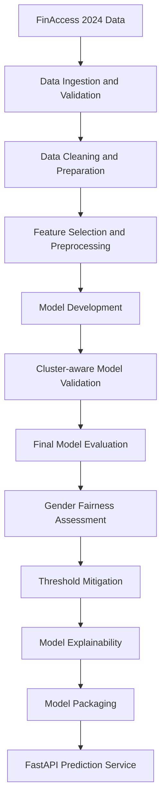

# Predicting Traditional Bank Use Among Kenyan Adults: A Machine Learning and Gender-Fairness Analysis

**DSA 8401 – Applied Machine Learning Capstone Project**  
**Strathmore University**

**Author:** Faith Makena Riungu

## 1. Project Overview

Financial inclusion in Kenya has expanded considerably over the years, supported by the growth of mobile money and digital financial services. However, access to financial services does not necessarily translate into the use of traditional banking products.

This project applies machine learning to predict traditional bank use among Kenyan adults using data from the **2024 FinAccess Household Survey**. In addition to evaluating predictive performance, it examines whether the selected model performs differently for women and men.

The project also investigates whether characteristics other than gender contain information that may indirectly reveal gender, and whether adjusting the model's decision threshold can reduce observed differences in prediction outcomes.

The final deliverable is an end-to-end machine learning pipeline that includes data preparation, model development, evaluation, fairness assessment, model explainability and a prediction API.

### Project at a glance

| Component | Description |
|---|---|
| Research area | Financial inclusion and machine learning |
| Data source | 2024 FinAccess Household Survey |
| Study population | Kenyan adults aged 18 years and above |
| Adult sample | 19,750 respondents |
| Selected data extract | 20,871 observations |
| Prediction target | Traditional bank use |
| Prediction task | Binary classification |
| Selected model | Gradient Boosting |
| Primary model-selection metric | Survey-weighted PR-AUC |
| Fairness dimension | Gender |
| Deployment | FastAPI and Docker |

## 2. Project Objectives

The main objective is to develop a machine learning model for predicting traditional bank use among Kenyan adults and assess whether its predictive performance differs between women and men.

The project addresses five questions:

1. How accurately can machine learning models predict traditional bank use using demographic, socioeconomic and household characteristics?
2. Which classification model provides the strongest predictive performance?
3. Does the selected model produce different prediction outcomes for women and men?
4. Can decision-threshold adjustment reduce observed gender disparities?
5. Which features contribute most to the model's predictions?

The analysis is predictive rather than causal. It identifies patterns in the survey data but does not establish that the observed characteristics cause traditional bank use.

## 3. Key Findings

Gradient Boosting achieved the highest mean survey-weighted PR-AUC during model comparison and was selected as the final model.

### Model performance

Results on the held-out test set:

| Metric | Survey-weighted result |
|---|---:|
| PR-AUC | **0.7530** |
| ROC-AUC | 0.8707 |
| Precision | 0.7333 |
| Recall | 0.6126 |
| F1-score | 0.6676 |
| Brier score | 0.1307 |

The weighted positive-class prevalence was approximately 0.304, providing a reference point for interpreting the PR-AUC.

### Gender-fairness findings

At the original classification threshold of 0.50, recall was approximately:

- Women: 51.9%
- Men: 67.5%

This represents a male-minus-female recall gap of approximately **15.6 percentage points**.

Using a common threshold of 0.320, selected from training out-of-fold predictions, reduced the gap to approximately **9.1 percentage points** on the test set.

However, this improvement was accompanied by an increase in the false-positive rate. The findings demonstrate that improving one aspect of fairness can involve trade-offs with other performance measures.

Gender was excluded from the model's prediction features but retained for fairness evaluation. Its exclusion does not automatically eliminate gender-related patterns in the remaining predictors.

## 4. Project Workflow

The project follows a sequence of stages, from data preparation to deployment.



The pipeline is implemented through individual Python modules in the `src/` directory. Each stage produces outputs used by subsequent stages.

## 5. Repository Structure

```text
├── src/
│   ├── config.py
│   ├── ingest.py
│   ├── clean.py
│   ├── train.py
│   ├── evaluate.py
│   ├── mitigate.py
│   ├── robustness.py
│   ├── proxy_check.py
│   ├── explain.py
│   ├── package.py
│   ├── run_pipeline.py
│   └── predict.py
│
├── api/
│   ├── main.py
│   ├── schema.py
│   ├── generate_schema.py
│   └── examples/
│
├── config/
│   └── raw_variable_map.csv
│
├── data/
│   ├── raw/
│   ├── processed/
│   └── sample/
│
├── models/
├── reports/
│   └── figures/
├── notebooks/
│   └── archive/
├── tests/
│
├── DECISIONS.md
├── TECHNIQUES.md
├── AI_USE.md
├── Dockerfile
├── docker-compose.yml
├── requirements-api.txt
└── requirements-lock.txt
```

### Main project directories

| Directory | Purpose |
|---|---|
| `src/` | Data processing, modelling, evaluation and prediction scripts |
| `api/` | FastAPI application and request schemas |
| `config/` | Data variable mapping and configuration files |
| `data/` | Raw, processed and sample datasets |
| `models/` | Trained models and model packages |
| `reports/` | Evaluation results, audit tables and figures |
| `notebooks/` | Archived exploratory analysis |
| `tests/` | Automated project tests |

## 6. Installation and Setup

### Requirements

- Python 3.11 or 3.12
- Git
- Docker Desktop (optional, for containerised deployment)

Clone the repository and navigate to the project directory.

Create a virtual environment:

```bash
python -m venv .venv
```

Activate it on Windows PowerShell:

```powershell
.venv\Scripts\Activate.ps1
```

On macOS or Linux:

```bash
source .venv/bin/activate
```

Install the dependencies:

```bash
python -m pip install --upgrade pip
pip install -r requirements-lock.txt
```

## 7. Running the Project

### Data preparation

The raw FinAccess workbook is not included in the repository.

Place the raw workbook in:

```text
data/raw/
```

Alternatively, use the selected data extract:

```text
data/processed/finaccess_selected.csv
```

To rebuild the selected extract from the raw workbook, update the variable mapping file:

```text
config/raw_variable_map.csv
```

Then run:

```bash
python -m src.ingest --raw data/raw/<workbook>.xlsx --force
```

### Run the complete pipeline

From the project root:

```bash
python -m src.run_pipeline
```

### Run an individual stage

For example:

```bash
python -m src.train
```

### Resume from a particular stage

```bash
python -m src.run_pipeline --from evaluate
```

### Run automated tests

```bash
python -m pytest
```

The pipeline uses a fixed random seed (`RANDOM_STATE = 42`) to support reproducibility. A complete rerun requires the relevant data files and project dependencies.

## 8. Model Prediction and API

The trained model can be used to generate predictions from a CSV file.

### Batch prediction

```bash
python -m src.predict \
    --input data/sample/sample_input.csv \
    --output reports/sample_predictions.csv
```

The prediction output includes the estimated probability, classification decision, decision threshold and model version.

### Run the FastAPI application

With the virtual environment activated:

```bash
uvicorn api.main:app --reload
```

The interactive API documentation is available at:

```text
http://localhost:8000/docs
```

### Available endpoints

| Endpoint | Description |
|---|---|
| `GET /health` | Checks whether the API is running |
| `GET /ready` | Checks whether the model is loaded |
| `GET /metadata` | Returns model and evaluation metadata |
| `POST /predict` | Generates a prediction for one respondent |
| `POST /predict/batch` | Generates predictions for a batch of up to 500 respondents |

### Run with Docker

With Docker Desktop running:

```bash
docker compose up --build -d
```

Check the container status:

```bash
docker compose ps
```

Stop the service:

```bash
docker compose down
```

## 9. Results and Project Outputs

The `reports/` directory contains the outputs generated during model development and evaluation.

Some of the main files include:

| File | Description |
|---|---|
| `model_cv_summary.csv` | Model comparison results |
| `test_overall_metrics.csv` | Overall test-set performance |
| `test_gender_metrics.csv` | Performance by gender |
| `test_gender_gaps.csv` | Differences in performance between gender groups |
| `test_segment_metrics.csv` | Performance across gender and location segments |
| `mitigation_comparison.csv` | Comparison of threshold strategies |
| `threshold_stability.csv` | Threshold stability analysis |
| `gender_proxy_check.csv` | Gender-proxy audit |
| `data_cleaning_audit.xlsx` | Data preparation and cleaning audit |

Additional visualisations are stored in:

```text
reports/figures/
```

## 10. Limitations and Responsible Use

The project has several limitations that should be considered when interpreting the findings.

- **Cross-sectional data:** The analysis uses one round of the FinAccess survey and does not capture changes in financial behaviour over time.
- **Prediction versus causation:** Model predictions and SHAP explanations identify statistical patterns, not causal relationships.
- **Gender-related information:** Other predictor variables may indirectly contain information associated with gender.
- **Fairness trade-offs:** Reducing disparities in one performance measure may increase errors in another.
- **Generalisation:** Performance on the held-out test set does not guarantee equivalent performance on future survey rounds or other populations.
- **Deployment scope:** The API is a technical demonstration, not a production-ready financial decision-making system.

The model should therefore be interpreted as an analytical tool for studying traditional bank use and evaluating predictive fairness, rather than as a system for determining an individual's eligibility for financial services.

## 11. Additional Documentation

The following documents provide further information about the project:

| Document | Description |
|---|---|
| `DECISIONS.md` | Records the main project decisions and the reasoning behind them |
| `TECHNIQUES.md` | Explains the machine learning techniques and methodological choices |
| `AI_USE.md` | Documents the use of AI assistance in the project |


**DSA 8401 – Applied Machine Learning Capstone Project**  
**Strathmore University**  
**Author: Faith Makena Riungu**

